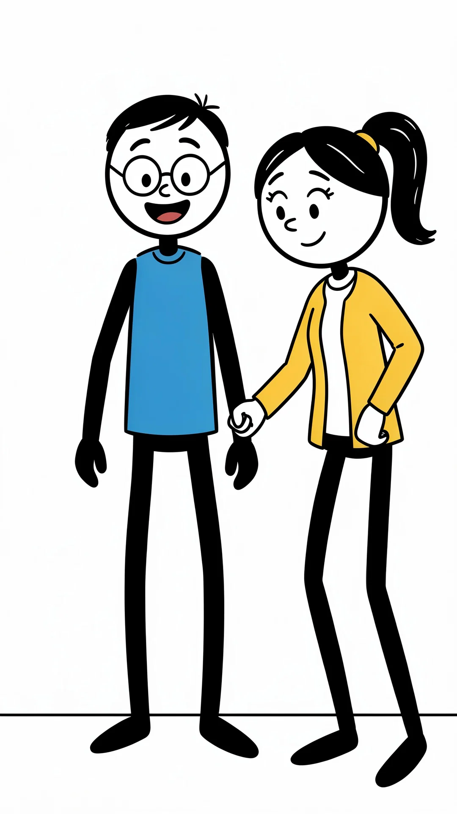

# Permanent couple reference procedure

The appearance/style rules in [the couple workflow](../workflows/stickman-couple-comedy.md) remain authoritative: minimal matching stick figures, round heads, dot faces, thin line bodies/limbs, stable character proportions/hair cues and the wife's ponytail; blue/yellow are casual outfit defaults. Keep outfits as simple flat drawn shapes; do not import detailed faces, modeled hands/feet or realistic anatomy.

## Approved image

The user supplied and approved [permanent-couple.png](permanent-couple.png) on 2026-10-31. Use this bundled image as the default identity reference unless the user supplies a newer one. It shows the husband on the left with round black glasses, short black hair and a blue shirt, and the wife on the right with a black ponytail, yellow hair tie and yellow cardigan over a white top. Both have white faces and black limbs. The file is the original uploaded PNG, unchanged. **Current user override: neither the husband nor the wife wears glasses.** The husband's glasses in this older source image must be omitted from every generated source and clip. Use the image for other identity cues; this override takes precedence over its eyewear.

At production setup, open and inspect the actual image, then select or upload it into VideoExpress through supported controls. Do not assume a repository link automatically attaches an image to VideoExpress. Reuse an existing matching My AI Images asset when available and record that verified asset privately. The repository does not establish a VideoExpress asset ID.

The image supplies identity cues; retain the existing workflow's simplified line-figure rendering rules. Adding this reference does not silently change the chosen style to detailed cartoon bodies.

Reuse the same permanent couple across new episodes and revisions. Do not generate fresh masters unless the user requests replacement. Record the selected reference privately and keep it in Consistent Character for every scene, including scene 1. Retain it through submissions and restore only when the visible control resets.

Use paired or separate references only as supported by the current UI. Do not displace a required identity reference with a room image; repeat exact set geometry in text when extra slots are unavailable. Do not claim perfect multi-character locking. Source images and final clips still require visual review.

Preserve full continuous stick limbs without hybrid realistic upper legs, missing lower legs, fused/extra limbs or humanlike wife designs. Neither spouse wears glasses in generated images or videos, including laughter and ending shots. Keep the approved simple style over reference-image detail as the existing workflow requires.

Keep private image/job IDs and screenshots out of public commits. Record actual inspection and limitations in [the run ledger](../templates/scene-ledger.md).

## Wardrobe is contextual

Use outfits appropriate to the story: pajamas/sleepwear for a nighttime bedroom or 3 AM bathroom trip, casual clothes at home, and simple activity/weather-appropriate clothes elsewhere. The bundled reference's blue shirt and yellow cardigan are not mandatory in every video. Preserve identity, minimal stick style and no glasses. Record each chosen outfit and keep it consistent across connected clips; change it only for a motivated story transition. See the workflow's wardrobe section.
